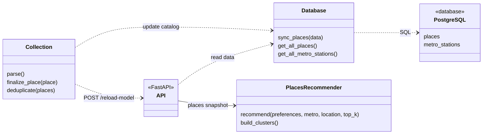

# Travel Planning Parser API

Серверная часть приложения «Мгновения Петербурга» для поиска городских мест и планирования прогулок по Санкт-Петербургу.

Проект объединяет сведения из нескольких источников в общий каталог и подбирает места по интересам пользователя. Сервер развёрнут отдельно; для демонстрации достаточно запустить Android-приложение по инструкции в его репозитории.

## Структура проекта

```text
app/
  api/               # Обработчики FastAPI и схемы запросов и ответов
  db/                # Работа с PostgreSQL и SQL-миграции
  ml/                # Рекомендации и профили интересов
  parser/            # Сбор данных из внешних источников
  utils/             # Нормализация, геокодирование и общие функции
  config.py          # Настройки из переменных окружения
  run_parser.py      # Запуск сбора и обновления каталога
tests/
  fixtures/          # Тестовые места и сценарии рекомендаций
.github/workflows/   # Автоматизированные проверки
```

## Возможности

- Сбор данных через Geoapify и peterburg.center, обогащение сведениями из Wikimedia.
- Нормализация координат, тегов и расписаний, поиск ближайшего метро и удаление дубликатов.
- Хранение каталога и станций метро в PostgreSQL.
- Персональный подбор по интересам, выбранному метро и переданным координатам.
- Тематические группы с постоянными идентификаторами.
- Обновление каталога и модели без удаления мест, отсутствующих в частичной выгрузке.

## Архитектура

UML-схема компонентов и основных интерфейсов:



## Рекомендательная система

Используется готовый многоязычный энкодер `paraphrase-multilingual-MiniLM-L12-v2` из SentenceTransformer. Ранжирование сочетает семантическое сходство названия, категории и тегов с интересами пользователя, расстоянием до переданной точки и бонусом выбранного метро. Затем применяется отбор по разнообразию.

Поддерживаются русские названия интересов и ключи категорий. Веса заданы вручную; тематические группы определяются правилами и словарями.

Результат — подборка мест. Расчёт пешеходного пути, времени переходов и проверка расписаний на момент посещения пока не реализованы.

## API

| Метод | Путь | Назначение |
| --- | --- | --- |
| GET | `/places` | Каталог мест |
| GET | `/clusters` | Тематические группы |
| GET | `/metro-stations` | Станции метро |
| POST | `/recommend` | Персональные рекомендации |
| GET | `/ping` | Проверка ответа сервера |
| POST | `/reload-model` | Обновление модели по служебному токену |

Описание запросов и ответов доступно на `/docs` работающего сервера. Android-клиенту служебный токен не требуется.

## Проверки

Настроены [GitHub Actions](.github/workflows/ci.yml) и автоматизированные тесты API, рекомендаций, сохранности данных и миграций PostgreSQL.

Для локального запуска тестов используется Python 3.11:

```bash
python -m pip install -r requirements.txt -r requirements-test.txt
python -m pytest tests/test_api.py tests/test_data_updates.py tests/test_migrations.py tests/test_model.py tests/evaluate_model.py -q
```

Тестам с настоящим энкодером нужны скачанные веса или доступ к сети. Проверки PostgreSQL используют отдельный тестовый сервер через `TEST_POSTGRES_DSN`; без него пропускаются.

[Набор мест](tests/fixtures/mock_places.json) и [пять сценариев рекомендаций](tests/fixtures/test_cases.json) включены в репозиторий. Они используются для регрессионных проверок; независимая оценка качества и сравнение с базовым алгоритмом пока не проводились.

Начальная схема находится в [SQL-миграциях](app/db/migrations), команда применения — `python -m app.db.migrate`. Миграции используют настройки `DB_*` из окружения, выполняются транзакционно и учитывают уже применённые версии.

## Лицензия

Код распространяется по [Apache License 2.0](LICENSE). Изображения и сведения о местах имеют собственные условия использования, определяемые их источниками.

Сведения о местах и геокодирование на сервере частично предоставляются [Geoapify](https://www.geoapify.com/).

Powered by [Geoapify](https://www.geoapify.com/) · © [OpenStreetMap contributors](https://www.openstreetmap.org/copyright).

Данные OpenStreetMap распространяются на условиях [Open Database License (ODbL)](https://www.openstreetmap.org/copyright). Использование Geoapify регулируется [условиями сервиса](https://www.geoapify.com/terms-and-conditions/).